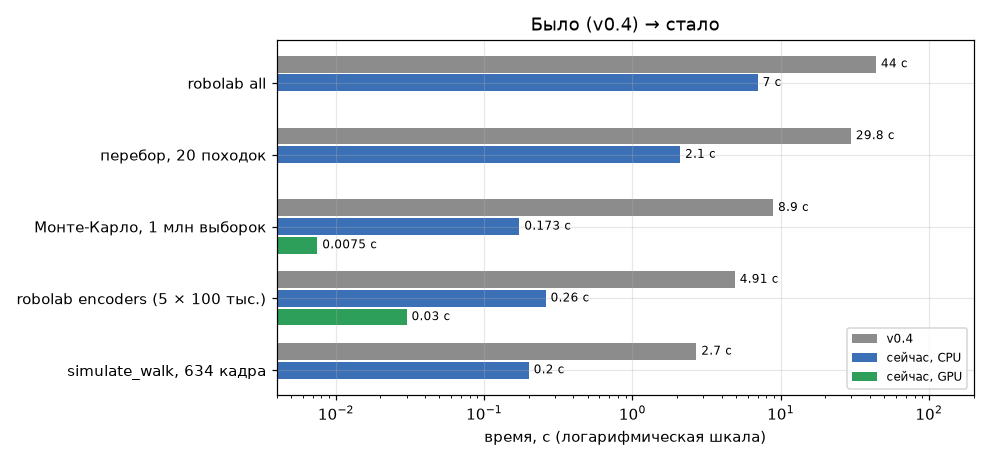
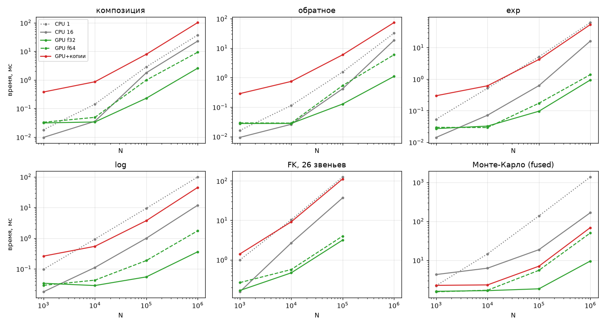
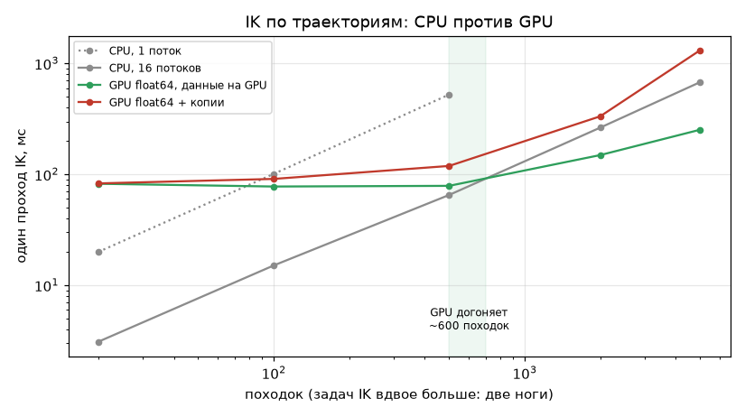
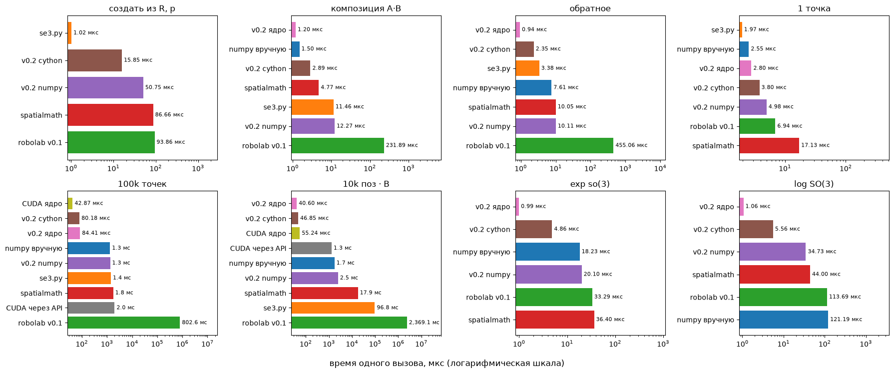
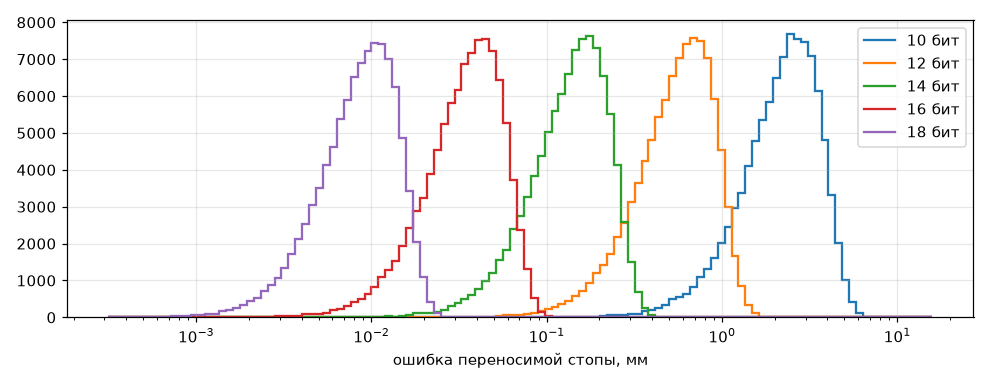
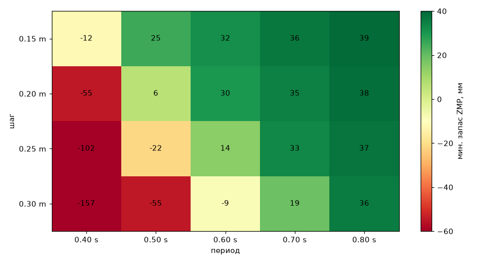
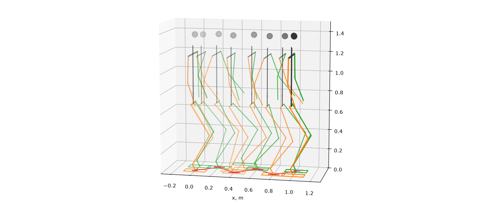
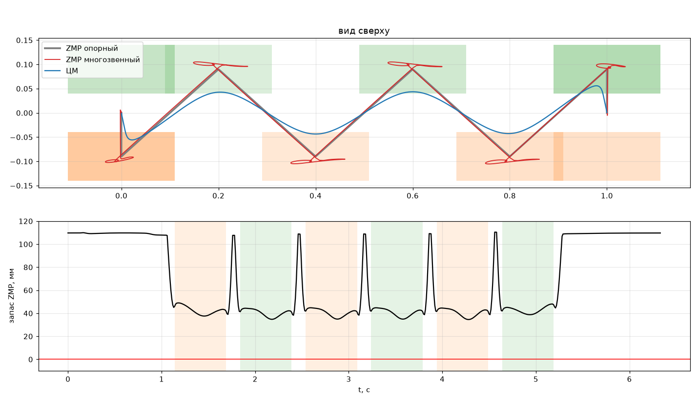

# robolab

Геометрия и кинематика антропоморфных роботов: SO(3)/SE(3) с проверкой систем координат, дерево звеньев, гуманоид на 21 DoF с симуляцией шага. Ядра на Cython + OpenMP и CUDA (CuPy), эталон на NumPy.

Замеры: Xeon E5-2667 v4 (8 ядер / 16 потоков), RTX 2060 SUPER, WSL2 Ubuntu 24.04, CUDA 12.6, CuPy 14.2.

## Результаты

| | v0.4 | Сейчас |
|---|---|---|
| `simulate_walk` (634 кадра) | 2.7 с | 0.20 с |
| Итерация IK | 240 мкс | 0.7 мкс |
| Перебор 20 походок | 29.8 с | 2.1 с |
| Монте-Карло, 1 млн выборок | 8.9 с | 0.17 с CPU / 7.5 мс GPU (ядро; со статистикой 16 мс) |
| `robolab encoders` | 4.9 с | 0.26 с CPU / 0.03 с GPU |
| `robolab all` | 44 с | 7 с |

Результаты те же: таблицы перебора и энкодеров совпадают с v0.4 до знака, походка — до 1e-15.



### Где выгоден GPU

Критерий: GPU хотя бы в 1.5 раза быстрее лучшего варианта CPU (1 или 16 потоков) при этом N и всех больших.

| Операция | Данные на GPU | С копиями по PCIe | Ускорение при 10⁶ |
|---|---|---|---|
| exp, log, FK | от 10⁴ | не выгоден | ×12–33 |
| композиция, обратное | от 10⁵ | не выгоден | ×9–17 |
| fused Монте-Карло | от 10⁴ | от 10⁴–10⁵ | ×17 |
| IK по траекториям | от ~600 походок | нет | ×2.7 на 5000 походок |

- Вызов GPU стоит ~30 мкс накладных расходов CuPy, а в WSL2 вызов с ожиданием результата — ~155–200 мкс.
- IK на GPU — только во float64: запас ZMP считается через вторые разности, и ошибка IK умножается в 10⁴ раз. При этом поток GPU на IK примерно в 100 раз медленнее ядра CPU, поэтому IK остаётся на CPU.





### Варианты трансформа

Ноутбук `notebooks/benchmark_transforms.ipynb`. Перед замером все 9 вариантов сверены с эталоном: CUDA с допуском float32 1e-5, остальные с 1e-9; расхождений нет. Подписи «v0.2» в ноутбуке относятся к текущему пакету. CUDA есть только в батчевых строках.

| | spatialmath | Cython | Ядро Cython | CUDA через API | CUDA ядро |
|---|---|---|---|---|---|
| композиция A·B | 4.8 мкс | 2.9 мкс | 1.2 мкс | — | — |
| exp so(3) | 36 мкс | 4.9 мкс | 1.0 мкс | — | — |
| 100 тыс. точек | 1.8 мс | 80 мкс | 84 мкс | 2.0 мс | 43 мкс |
| 10 тыс. поз · B | 17.9 мс | 47 мкс | 41 мкс | 1.3 мс | 55 мкс |



### Точность

- Float32 в Монте-Карло: ~1e-7 от величины ошибки (FK считается в форме отклонений от номинала). Для 18-битных энкодеров это 6e-12 м при эффекте 17 мкм.
- Перебор походок на GPU (float64) совпадает с CPU до 3.6e-10 мм при критерии 0.1 мм.





### Шаг гуманоида

6 шагов по 0.20 м, период 0.7 с: симуляция 0.20 с, 11 435 итераций IK без неудач; ZMP всё время внутри опоры, минимальный запас 34.6 мм.





## Установка

```bash
pip install -e '.[test,plot]'          # соберёт Cython-ядро (+OpenMP); без компилятора — чистый NumPy
pip install -e '.[cuda]'               # CUDA-бэкенд: CuPy с заголовками CUDA
python -m pytest -q
```

Raspberry Pi, Jetson и другие машины без дисплея (64-битная Ubuntu/Debian): `bash scripts/install_pi.sh` ставит apt-пакеты, venv `~/robolab-venv`, собирает ядро и прогоняет тесты.

Переменные сборки: `ROBOLAB_NO_CYTHON=1`, `ROBOLAB_NO_OPENMP=1`, `ROBOLAB_NATIVE=1`. Ядро во время работы: `ROBOLAB_PURE_PYTHON=1` или `set_backend("python"|"cython")`, потоки: `set_num_threads(n)`.

## Командная строка

```bash
robolab info | walk | sweep | encoders | bench | all
robolab all --quick                    # всё сразу, результаты в ./results
robolab encoders --device cuda         # Монте-Карло на GPU
robolab sweep --device cuda            # IK перебора на GPU (float64)
robolab bench --device cuda            # CPU против GPU по N = 10³…10⁶
```

Опции: `--quick`, `--gif`, `--threads N`, `--samples N`, `--step-length`, `--step-time`, `--steps`, `--out DIR`, `--lang ru|en`, `--device cpu|cuda`, `--dtype float32|float64`. Таблицы печатаются в терминал и в `results/report.md`, графики — в `results/*.png`, траектории суставов — в `joint_trajectory.csv` (шаг 10 мс) и `walk.npz`.

## API

```python
import numpy as np
from robolab.transforms import SE3, SO3, SE3Array, set_batch_backend
from robolab.humanoid import GaitParams, make_humanoid, simulate_walk, simulate_walks
from robolab.humanoid.analysis import encoder_quantization_mc, mc_summary

T_world_pelvis = SE3(SO3.Rz(0.5), [0, 0, 0.9], parent="world", child="pelvis")
T_pelvis_foot = SE3.Trans(0, -0.1, -0.8, parent="pelvis", child="foot")
T_world_foot = T_world_pelvis @ T_pelvis_foot          # world <- foot; неверный порядок -> FrameMismatchError
traj = SE3Array.exp(np.random.randn(1000, 6), parent="world", child="foot")

robot = make_humanoid()                                # 21 DoF, 26 звеньев
P = robot.fk_batch(np.random.uniform(-0.3, 0.3, (10_000, robot.nq)))    # (N, 26, 4, 4), один вызов ядра
walk = simulate_walk(robot, GaitParams(step_length=0.2, step_time=0.7))
walks = simulate_walks(robot, [GaitParams(step_time=t) for t in (0.5, 0.6, 0.7)])  # IK всех походок одним вызовом

r = encoder_quantization_mc(robot, walk.q[200], walk.base[200], bits=16, n_samples=1_000_000,
                            rng=np.random.default_rng(0), device="cuda")
mc_summary(r)                                          # ошибка стопы и ЦМ, мм; ориентации, °

set_batch_backend("cuda", min_batch=4096)              # батчи SE3Array и fk_batch на GPU, мелкие — на CPU
```

## Устройство

```
robolab/transforms/   _core_py.py (эталон = спецификация), _core_cy.pyx (Cython + OpenMP),
                      _core_cuda.py (CuPy RawModule), _backend.py (выбор ядра),
                      lie.py, so3.py, se3_group.py, se3_array.py, functional.py (API v0.1)
robolab/kinematics/   tree.py: Link, KinematicTree (FK, якобианы, ЦМ, IK)
robolab/humanoid/     model, gait (preview-регулятор ZMP), walk, balance, analysis (Монте-Карло)
robolab/cli.py        команда robolab;  robolab/gpubench.py — замеры для bench --device cuda
notebooks/            сравнение вариантов трансформа, симуляция шага (Colab)
legacy/               исходные se3.py и robolab v0.1
```

- **Три слоя.** Ядро не проверяет вход. Группы (`SO3`, `SE3`, `SE3Array`) проверяют инвариант один раз в конструкторе. Функциональный API v0.1 проверяет вход в каждой функции.
- **Паритет ядер.** Каждая функция ядра сначала пишется в `_core_py`, затем в Cython и CUDA с той же сигнатурой; `tests/test_kernel_parity.py` сверяет их.
- **Fused-ядра.** `mc_relative_pose` (FK → относительная поза → ошибки) и `ik_dls_traj` (IK по всей траектории) отдают только итог, без промежуточных поз.

## Соглашения

- Векторы-столбцы, правосторонние системы, активные повороты, радианы, метры.
- `T_A_B` переводит координаты из B в A, композиция `T_A_B @ T_B_C → T_A_C`.
- Твист ξ = (ω, v), как в Lynch & Park; в spatialmath и Sophus наоборот, (v, ω).
- `log` главный, угол в [0, π]. Допуск 1e-9; данные из float32 исправляются явно: `from_matrix(project=True)`.
- Объекты неизменяемы; `==` и `hash` намеренно бросают `TypeError`, сравнение через `isclose`.

## Тесты

301 тест; без CuPy или GPU CUDA-тесты пропускаются. Тесты групп и API идут на каждом ядре: `test_math`, `test_api`, `test_compat_v01`, `test_vs_spatialmath`. Остальные:
- `test_kernel_parity` — Cython и CUDA (float32/float64) против NumPy-спецификации;
- `test_kinematics` — FK, якобианы, IK, походка, одинаковая на всех ядрах;
- `test_monte_carlo` — Монте-Карло;
- `test_gpubench` — замеры для `bench --device cuda`.

## Ограничения

- Симуляция кинематическая: контакт идеальный, звенья — точечные массы, приводы точно отрабатывают углы. Для динамики нужен физический движок (MuJoCo, Drake, Pinocchio).
- `mc_relative_pose` поддерживает деревья до 64 звеньев, CUDA-IK — пути до 32 звеньев.
- Нет SO(2)/SE(2); точки не типизированы по системам координат.
